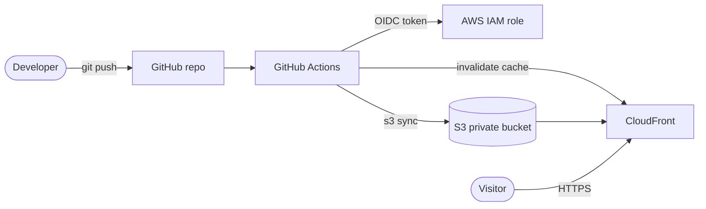

**I build and automate AWS infrastructure: CI/CD pipelines, Infrastructure as Code, and secure, keyless deployments.**

---

### 👋 About me

- ☁️ I learn **AWS and DevOps by building real projects**, not only tutorials.
- 🏗️ I built and deployed a **live website for a car workshop in Mylapore, Chennai** on AWS (S3 + CloudFront) with automated CI/CD and an offline billing app for the owner.
- 🛒 I built **Aruvi**, a full-stack study-kit store (Next.js, Supabase, Razorpay in test mode) with server-side payment verification, signed admin sessions and CI on every push.
- 🔐 I care about security basics: no stored AWS keys (OIDC), private buckets, least-privilege IAM, no secrets in git.
- 🎯 Looking for **fresher Cloud / DevOps Engineer** roles. 📍 Chennai, India.
- 📧 **[v.subash2410@gmail.com](mailto:v.subash2410@gmail.com)**

---

### 🛠️ Tech stack

**Hands-on (used in my projects)**

**Learning next**

Also exploring: Helm, serverless on AWS (Lambda, API Gateway, DynamoDB).

---

### 🚀 Featured projects

| Project | What it shows | Links |
|:--|:--|:--|
| **🛒 Aruvi Store** | Next.js + Supabase + Razorpay (test mode) store with server-side payment verification, signed admin sessions, CI on every push and Vercel deploy | [Code ➜](https://github.com/subashvelu/aruvi-store) · [Live ➜](https://aruvi-store.vercel.app) |
| **🚗 Intech Motors Site** | AWS **S3 + CloudFront** hosting, **CloudFormation**, **GitHub Actions with OIDC (no stored keys)**, offline billing PWA | [Code ➜](https://github.com/subashvelu/intech-motors-site) · [Live ➜](https://d166dz9n7bj9t4.cloudfront.net) |
| **☁️ DevOps Cloud App** | Terraform-provisioned AWS infrastructure (ALB, EC2) with a Dockerised app deployed through GitHub Actions | [Code ➜](https://github.com/subashvelu/devops-cloud-app) |
| **🖥️ Linux Health Monitor** | Bash automation that tracks CPU, memory and storage and raises threshold alerts | [Code ➜](https://github.com/subashvelu/linux-health-monitor) |
| **⚡ Maxera Website** | Next.js storefront with Supabase and Razorpay checkout | [Code ➜](https://github.com/subashvelu/maxera-website) |

<b>🔍 How the Intech Motors pipeline works</b>

---

### 🗺️ What I am building next

| | Project | Skills |
|:-:|:--|:--|
| ✅ | Static site on S3 + CloudFront with CI/CD | S3, CloudFront, IAM, OIDC, CloudFormation, GitHub Actions |
| ✅ | AWS infrastructure as code | Terraform, ALB, EC2 |
| ✅ | Dockerised app with automated deploy | Docker, ECR, EC2, GitHub Actions |
| ✅ | Full-stack store with payments and hardened APIs | Next.js, Supabase, Razorpay, Vercel |
| 📅 | Serverless quote-request API | Lambda, API Gateway, DynamoDB, SNS |
| 📅 | Security scanning in the pipeline | Checkov, Trivy, Dependabot |

✅ done · 📅 planned

---

### 🐍 My contribution graph

---

📫 Reach me on [LinkedIn](https://www.linkedin.com/in/subash-v-3295812b6) or by [email](https://mail.google.com/mail/?view=cm&fs=1&to=v.subash2410%40gmail.com) · ⭐ A star is always appreciated

